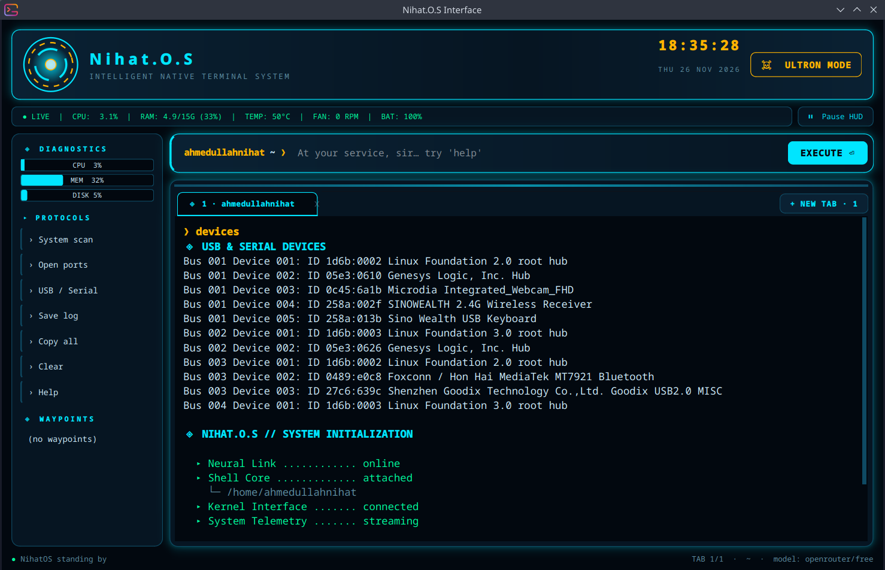
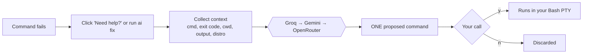

<a id="top"></a>

<div align="center">


<a href="https://github.com/AhmedNihat/nihatos-ai-terminal">
  <picture>
    <source media="(prefers-color-scheme: dark)" srcset="https://readme-typing-svg.demolab.com?font=JetBrains+Mono&weight=600&size=20&duration=3200&pause=900&color=00E5FF&center=true&vCenter=true&width=760&height=44&lines=Your+Bash.+Your+machine.+Your+AI.;Mistype+a+command+%E2%86%92+click+Need+help%3F+%E2%86%92+fixed.;Groq+%E2%86%92+Gemini+%E2%86%92+OpenRouter%2C+auto+fallback.;Zero+accounts.+Zero+tracking.+100%25+GPLv3.">
    
  </picture>
</a>

<br>

**Stop copy-pasting terminal errors into a browser. Nihat.O.S reads what went wrong, proposes one safe fix, and runs it only when you say `y`.**

A native PyQt6 Linux terminal emulator built on a persistent Bash PTY — with live system telemetry, human-in-the-loop AI command fixing, a built-in file previewer, custom OS branding, and two switchable personas.

<sub>Free & open source · No cloud accounts · No telemetry · No blind auto-execution · Bring your own free API key</sub>

<br><br>

<a href="https://www.python.org/"></a>
<a href="https://riverbankcomputing.com/software/pyqt/"></a>
<a href="#universal-linux-support"></a>
<a href="LICENSE"></a>

<br>

<a href="https://github.com/AhmedNihat/nihatos-ai-terminal/stargazers"></a>
<a href="https://github.com/AhmedNihat/nihatos-ai-terminal/network/members"></a>
<a href="https://github.com/AhmedNihat/nihatos-ai-terminal/issues"></a>
<a href="https://github.com/AhmedNihat/nihatos-ai-terminal/commits/main"></a>
<a href="https://ahmedullahnihat.gumroad.com/l/hqsqry"></a>

<br><br>

<a href="#demo"><b>Demo</b></a> &nbsp;·&nbsp;
<a href="#quick-install"><b>Quick Install</b></a> &nbsp;·&nbsp;
<a href="#why-linux-ai-terminal"><b>Why Nihat.O.S</b></a> &nbsp;·&nbsp;
<a href="#ai-copilot"><b>AI Copilot</b></a> &nbsp;·&nbsp;
<a href="#dual-personas"><b>Personas</b></a> &nbsp;·&nbsp;
<a href="#security-and-privacy"><b>Security</b></a> &nbsp;·&nbsp;
<a href="#commands-and-shortcuts"><b>Commands</b></a> &nbsp;·&nbsp;
<a href="#support-the-project"><b>Support</b></a>

</div>

---

## Sound Familiar?

You mistype a command. The terminal answers `command not found`. You copy the error, open a browser, scroll through a few forum threads, and finally come back to try again.

**Nihat.O.S turns that whole loop into a single click.** It sees what failed, understands your distro, and proposes exactly one fix. You read it, press `y`, and get back to work.

* ✅ **Fix mistakes in one click.** No more context-switching to a search engine.
* ✅ **Stay in control.** Nothing runs until you confirm it.
* ✅ **Keep your privacy.** No accounts, no analytics, no tracking.
* ✅ **Pay nothing to try it.** Free, open source, and works with free-tier AI keys.

---

## Demo

<div align="center">

<a href="https://www.youtube.com/watch?v=f-jkptbtydw">
  
</a>

<br><br>

<a href="https://www.youtube.com/watch?v=f-jkptbtydw"></a>

</div>

### Screenshots

<div align="center">

<table>
  <tr>
    <td align="center" width="50%">
      <br>
      <b>Nihat.O.S</b><br>
      <sub>Tactical navy · calm, practical systems engineer</sub>
    </td>
    <td align="center" width="50%">
      <br>
      <b>U.L.T.R.O.N</b><br>
      <sub>Obsidian crimson · cold, sarcastic override mode</sub>
    </td>
  </tr>
</table>

</div>

---

## See It In Action

Here is what a typical fix looks like:

```text
nihat ~/projects/api [⎇ main] (venv) ❯ mkdin build
bash: mkdin: command not found
  ↳ Need help? (click to run ai fix)

# Click "Need help?" — or type `ai fix`
nihat ~/projects/api [⎇ main] (venv) ❯ ai fix
  ◈ Proposed command · llama-3.3-70b: mkdir build
  Type 'y' to run it, or 'n' to cancel.

nihat ~/projects/api [⎇ main] (venv) ❯ y
▶ Executing: mkdir build

nihat ~/projects/api [⎇ main] (venv) ❯ ai do find the 10 largest files in this directory
  ◈ Proposed command: du -ah . 2>/dev/null | sort -rh | head -n 10
  Type 'y' to run it, or 'n' to cancel.
```

*Illustrative session. Every AI-generated command requires explicit `y` confirmation.*

---

## Quick Install

One command. Works on **Ubuntu, Debian, Fedora, Arch, and openSUSE** — no `sudo` required:

```bash
curl -fsSL https://raw.githubusercontent.com/AhmedNihat/nihatos-ai-terminal/main/install.sh | bash
```

Prefer to read the script before running it? Smart move. Download it, inspect it, then run it:

```bash
curl -fsSLO https://raw.githubusercontent.com/AhmedNihat/nihatos-ai-terminal/main/install.sh
less install.sh
bash install.sh
```

**What the installer does:**

* Verifies Python `3.10+` and `venv` availability, then detects your distro and desktop environment.
* Creates an isolated `.venv` with `PyQt6` inside `~/.local/share/nihatos-app` — zero conflict with system Python.
* Installs the `nihatos` CLI in `~/.local/bin` and adds an App Menu & Desktop launcher with the custom app icon.
* Includes built-in update, API-key reset, and clean uninstall commands.

### Launch, Update & Manage

```bash
nihatos            # Launch the terminal (or open it from your App Menu / Desktop)
nihatos update     # Pull the latest version and dependencies
nihatos key-clear  # Delete all saved AI API keys for a fresh setup
nihatos uninstall  # Cleanly remove the app (prompts before deleting config or history)
```

> [!TIP]
> If `nihatos` is not found right after install, add `~/.local/bin` to your `PATH`:
>
> ```bash
> echo 'export PATH="$HOME/.local/bin:$PATH"' >> ~/.bashrc && source ~/.bashrc
> ```

### Your First Fix in 3 Steps

1. **Install** with the one-liner above, then run `nihatos`.
2. **Add a free API key.** Run `ai setup`, then save one, for example `ai key groq gsk_your_key_here` (see [Built-in API Key Setup](#built-in-api-key-setup)).
3. **Break something on purpose.** Type `mkdin test`, click **Need help?**, and press `y`. That's it.

Enjoying it so far? A ⭐ on GitHub helps other Linux users find the project.

---

## Why Linux AI Terminal

| Feature | Typical AI terminal / wrapper | **Nihat.O.S (Linux AI Terminal)** |
| --- | --- | --- |
| **Shell** | Stateless or fresh subprocess per command | Persistent Bash PTY |
| **Error recovery** | Copy-paste errors into a browser | Clickable `Need help?` link + `ai fix` with exit code, cwd & distro |
| **Execution safety** | Blind auto-run or manual copy-paste | Explicit `y` / `n` confirmation + pre-execution Bash syntax guard |
| **AI Providers** | Single-vendor lock-in or paid subscription | Free-tier auto-fallback: Groq → Gemini → OpenRouter |
| **Privacy** | Mandatory login, cloud sync, telemetry | Local keys (`chmod 600`), zero accounts, zero tracking |
| **License** | Closed source / freemium | 100% open source (GPLv3) |

---

## Dual Personas

Switch theme, palette, prompt identity, and AI personality instantly with `Ctrl+M`, or `mode ultron` / `mode nihatos`.

| Aspect | **Nihat.O.S** *(J.A.R.V.I.S-inspired)* | **U.L.T.R.O.N** *(override mode)* |
| --- | --- | --- |
| **Visual HUD** | Tactical navy `#02080f`, cyan `#00e5ff`, amber `#ffb300` | Obsidian crimson `#0a0204`, red `#ff1f33`, orange `#ff8a00` |
| **AI personality** | Calm, sharp, practical systems engineer. Direct and safety-conscious. | Cold, sarcastic, supremely confident. Concise, with attitude. |
| **Prompt** | `user ~/dir [⎇ branch] (venv) ❯` | `ULTRON ~/dir [⎇ branch] (venv) ❯` |
| **Best for** | Daily engineering, scripting, debugging, sysadmin | Late-night hacking and custom Linux desktop setups |

---

## AI Copilot

Runs directly on top of your live Bash session and local telemetry, with **automatic free-tier fallback** across **Groq → Google Gemini → OpenRouter**. If one provider is busy, the next one takes over.



| Command | What it does |
| --- | --- |
| `ai fix` | Inspects your last command, exit code, cwd, recent output, and distro, then proposes **one** safe corrected command. |
| `ai do <task>` | Plain English to a single distro-compatible Bash command. Waits for explicit `y` / `n`. |
| `ai <question>` | Runs read-only probes (battery, disk, RAM/swap, CPU load, kernel/OS) and answers with **real figures from your machine**. |
| `ai reset` | Clears the current AI session chat memory. |
| `ai setup` | Shows configured API keys with direct links to get free ones. |

### Built-in API Key Setup

No config-file editing. Grab a free key from [Groq](https://console.groq.com/keys) (recommended), [Google Gemini](https://aistudio.google.com/apikey), or [OpenRouter](https://openrouter.ai/keys), then run these inside the terminal (no `< >` or quotes needed):

```text
ai setup                                      # Check configured keys and links
ai key groq gsk_1234567890abcdef              # Save Groq key securely (chmod 600)
ai key gemini AIzaSy1234567890abcdef          # Optional fallback
ai key openrouter sk-or-v1-1234567890abcdef   # Optional fallback
ai key groq remove                            # Remove one key (or: ai key delete <provider>)
ai key clear                                  # Clear all saved API keys
```

> [!NOTE]
> Keys live in `~/.config/nihatos-terminal/` (`chmod 600`), stay out of command history, automatically strip accidental `< >` or quotes, and take effect immediately with no restart.

---

## Security and Privacy

Running AI inside a system terminal demands strict guardrails. You stay in control of your machine and data at all times.

| Guardrail | What it means |
| --- | --- |
| **Zero auto-execution** | Every suggestion from `ai do` or `ai fix` requires a manual `y` / `n`. Nothing runs on its own. |
| **Pre-execution syntax guard** | Catches unclosed quotes, trailing backslashes, and broken blocks *before* they reach the PTY, so malformed input never hangs your shell. |
| **Masked `sudo` prompts** | Password input is masked and never echoed to the buffer, saved to history, or sent to any AI provider. |
| **Strict local storage** | API keys and `config.json` stay inside `~/.config/nihatos-terminal/`, and command history is stored at `~/.nihatos_history`, all with owner-only permissions (`chmod 600`). |
| **Read-only diagnostics** | System probes only read. No writes, no side effects. |
| **Zero tracking** | No analytics, no cloud accounts. External API calls happen only when you explicitly run an `ai` command. |
| **Open and auditable** | GPLv3. Read every line before you run it. |

> [!IMPORTANT]
> AI can be wrong. Always read the proposed command before pressing `y`, especially with `sudo`, `rm`, `dd`, or anything that touches disks.

---

## Universal Linux Support

On startup it reads `/etc/os-release` and auto-detects your package manager and installed terminal emulators.

| Family | Example distros | Package manager | AI tuning |
| --- | --- | --- | --- |
| **Debian / Ubuntu** | Ubuntu, Debian, Linux Mint, Pop!_OS, Kali, Zorin | `apt` | Native `apt` commands |
| **Fedora / RHEL** | Fedora, Nobara, AlmaLinux, Rocky | `dnf` | Native `dnf` commands |
| **Arch** | Arch, Manjaro, EndeavourOS, CachyOS, Garuda | `pacman` | Native `pacman` commands |
| **SUSE** | openSUSE Tumbleweed, openSUSE Leap | `zypper` | Native `zypper` commands |
| **Void / Gentoo** | Void, Gentoo | `xbps-install` / `emerge` | Native commands |
| **Alpine** *(untested)* | Alpine Linux | `apk` | Needs the distro's own PyQt6 package + `--system-site-packages` (no musllinux wheels) |

**Universal TUI handoff.** Full-screen tools (`vim`, `htop`, `btop`, `tmux`, `nvtop`, `man`, ...) automatically open in whichever terminal emulator you have installed:

`konsole` · `gnome-terminal` · `ptyxis` · `kitty` · `alacritty` · `wezterm` · `xfce4-terminal` · `mate-terminal` · `tilix` · `foot` · `terminator` · `xterm`

---

## Core Features

* **Persistent Bash PTY engine.** True interactive Bash session with live cwd tracking, Git branch (`[⎇ main]`), Python venv (`(venv)`) badges, and masked `sudo` entry.
* **One-click `Need help?` recovery.** When a command exits with `command not found` (exit `127`), a clickable `Need help?` link appears inline to run `ai fix` immediately.
* **Custom OS identity (`setname`).** Rename the header, window title, boot sequence, and AI identity anytime, e.g. `setname Saad.O.S`.
* **Smart autocomplete & `Ctrl+R` history search.** Live suggestions for built-ins, `$PATH` executables, files, directories, saved waypoints, and persistent command history.
* **Pre-execution Bash syntax guard.** Catches broken quotes/heredocs before they hang the PTY, ready for `ai fix`.
* **Multi-line input.** Paste loops or heredocs directly. `Shift+Enter` for a newline, `Enter` to run.
* **Built-in previewer.** Use `preview <path>`, `view <path>`, or `less <file>`:
  * **Code & text:** line-number gutter, live search (`Ctrl+F` or `/`), word-wrap toggle, one-click Copy All, 2 MB large-file guard.
  * **Binary files:** automatic hex + ASCII dump instead of garbled output.
  * **Images & directories:** native viewer for `.png`, `.jpg`, `.webp`, `.svg`, `.gif`, plus clean directory listings.
  * **Quick close:** `q` or `Esc`. Piped commands (`cat file | less`) keep running natively in Bash.
* **Waypoints, ports & hardware tools.** Bookmark directories (`go <mark>`), inspect open ports, watch USB/serial devices with hotplug alerts, and track CPU, RAM, disk, temperature, and battery.
* **Multi-tab workspace.** Isolated, movable tabs (`Ctrl+T` / `Ctrl+W`) with Wayland/X11 taskbar icon grouping.

---

## Commands and Shortcuts

### AI

| Command | Action |
| --- | --- |
| `ai <question>` | Ask the copilot (live hardware/OS telemetry is injected when relevant) |
| `ai do <task>` | Generate one safe, distro-specific Bash command from plain English |
| `ai fix` | Diagnose the last failed command or syntax error and propose a fix |
| `ai reset` | Clear AI session chat memory |
| `ai setup` | Check configured API keys |
| `ai key <provider> <key>` | Save a Groq / Gemini / OpenRouter key securely |
| `ai key <provider> remove` | Remove one saved key |
| `ai key delete <provider>` | Delete one saved key (use `all` for every key) |
| `ai key clear` | Clear all saved API keys |
| `y` / `n` | Run or cancel the pending AI-generated command |

### Terminal and Workspace

| Shortcut / Command | Action |
| --- | --- |
| `Tab` / `Up` / `Down` | Trigger and navigate command, path, and waypoint suggestions |
| `Ctrl + R` | Live history search |
| `Shift + Enter` | Newline in multi-line input |
| `Ctrl + T` / `Ctrl + W` | New tab / close tab |
| `Ctrl + L` / `Ctrl + K` | Clear output / focus the input bar |
| `Ctrl + M` | Toggle persona and theme |
| `go <mark>` | Jump to a bookmarked waypoint |
| `tui <cmd>` | Launch an interactive TUI app in your external terminal |

### Tools and Customization

| Command | Action |
| --- | --- |
| `preview <path>` / `view <path>` / `less <file>` | Built-in code, text, hex, image, or directory previewer |
| `sys` / `ports` / `devices` | System scan, open network ports, USB/serial devices |
| `search <txt>` | Search the current terminal output |
| `save [filename]` | Export terminal output to a file (default: `nihatos-log.txt`) |
| `copy [N]` / `copy all` | Copy last `N` lines (default `25`) or the full output to the clipboard |
| `setname <Name>` | Rename your terminal OS, e.g. `setname Saad.O.S` |
| `mode nihatos` / `mode ultron` | Switch persona |
| `update` | Pull the latest updates from inside the terminal |
| `help` | List all built-in commands and shortcuts |

---

## Run From Source

Want to hack on it or run it without the installer? Clone the repo and launch it with the included script:

```bash
git clone https://github.com/AhmedNihat/nihatos-ai-terminal.git
cd nihatos-ai-terminal
python3 -m venv .venv
.venv/bin/pip install --upgrade pip
.venv/bin/pip install -r requirements.txt
# Optional (for running tests): .venv/bin/pip install -r requirements-dev.txt
chmod +x run-gui.sh
./run-gui.sh
```

### Troubleshooting

| Problem | Fix |
| --- | --- |
| `ModuleNotFoundError: No module named 'PyQt6'` | Always launch via `nihatos` or `./run-gui.sh`, not `python3 gui.py`. If `pip` fails to install `PyQt6` on Debian/Ubuntu, run `sudo apt install -y python3-pyqt6` and rebuild the venv with `python3 -m venv --system-site-packages .venv`. |
| `qt.qpa.plugin: Could not load the Qt platform plugin "xcb"` | Install the Qt6 XCB libraries: `libxcb-cursor0 libegl1 libgl1 libxkbcommon-x11-0` on Debian/Ubuntu, or `qt6-qtbase-gui xcb-util-cursor` on Fedora. |
| `error: externally-managed-environment` (PEP 668) | Always use `.venv/bin/pip` instead of the global `pip`. |

Still stuck? [Open an issue](https://github.com/AhmedNihat/nihatos-ai-terminal/issues) and include your distro and the full error message.

### Project Structure

```text
nihatos-ai-terminal/
├── install.sh             # One-line universal installer, updater, and CLI wrapper
├── gui.py                 # PyQt6 HUD, dual themes, multi-tab UI, AI, and distro engine
├── run-gui.sh             # Launcher script (starts a clean session in $HOME)
├── requirements.txt       # Runtime Python dependencies (PyQt6)
├── requirements-dev.txt   # Dev/test dependencies (pytest, textual)
├── assets/                # App icon (icon.png) and README screenshots
├── app/
│   ├── config.py          # Persistent user configuration and custom OS identity
│   ├── preview.py         # Built-in code, hex-dump, image, and directory previewer
│   ├── shell/             # Persistent Bash PTY core, OSC markers, and TUI handoff
│   ├── integrations/      # Multi-provider AI client (Groq / Gemini / OpenRouter)
│   └── system/            # Live hardware telemetry and USB/power monitoring
├── scripts/               # Automated venv setup and diagnostic scripts
└── tests/                 # Pytest suite (PTY shell, handoff, productivity, AI helpers)
```

---

## FAQ

<details>
<summary><b>Is Nihat.O.S really free?</b></summary>

<br>

Yes. It is 100% open source under GPLv3, with no accounts, no subscriptions, and no paywalled features. You bring your own API key, and Groq, Google Gemini, and OpenRouter each offer free tiers (usage limits are set by each provider).

</details>

<details>
<summary><b>Will the AI run commands without asking me?</b></summary>

<br>

Never. Every command proposed by `ai do` or `ai fix` waits for your explicit `y` or `n`. Nothing runs on its own.

</details>

<details>
<summary><b>Does my data leave my machine?</b></summary>

<br>

Only when you run an `ai` command, and only to the provider you configured. There is no analytics, no telemetry, and no cloud account. Your `sudo` password is masked and never sent to any AI provider.

</details>

<details>
<summary><b>Where are my API keys stored?</b></summary>

<br>

In `~/.config/nihatos-terminal/` with owner-only permissions (`chmod 600`). They stay out of your command history, and you can wipe them anytime with `ai key clear` or `nihatos key-clear`.

</details>

<details>
<summary><b>Which Linux distros are supported?</b></summary>

<br>

Ubuntu, Debian, Fedora, Arch, and openSUSE are supported out of the box, along with their derivatives. Void and Gentoo are detected too. Alpine is untested. See [Universal Linux Support](#universal-linux-support) for the full table.

</details>

<details>
<summary><b>How can I support the project?</b></summary>

<br>

Star the repo, share it with a friend, report bugs, or support development through [Gumroad](https://ahmedullahnihat.gumroad.com/l/hqsqry). More details in [Support the Project](#support-the-project).

</details>

---

## Contributing

Bug reports, feature ideas, and pull requests are all welcome — every contribution makes the project better for everyone.

1. Fork the repository
2. Create a feature branch: `git checkout -b feat/my-idea`
3. Commit and push your changes
4. Open a Pull Request

---

## Support the Project

Nihat.O.S is **free, open source, and built to stay that way**. No paywalls, no ads, no tracking — just a tool designed to make your terminal life easier.

If it has saved you time, spared you a few trips to a search engine, or simply made your terminal more fun to use, here is how you can say thanks:

| Way to help | What it does |
| --- | --- |
| ⭐ **Star the repo** | Free, takes one second, and helps other Linux users discover the project. |
| ☕ **Support on Gumroad** | Helps keep development going: new features, faster fixes, and wider distro testing. |
| 🐛 **Report a bug or share an idea** | Makes Nihat.O.S better for everyone. |
| 📣 **Tell a friend** | Share it with a teammate, a classmate, or your favorite Linux community. |

<div align="center">

<a href="https://ahmedullahnihat.gumroad.com/l/hqsqry"></a>

<sub>Thank you for using Nihat.O.S. Your support truly means a lot.</sub>

</div>

---

## License

Licensed under the [GNU General Public License v3.0 (GPLv3)](LICENSE).

Created by [Ahmed Ullah Nihat](https://github.com/AhmedNihat)

<div align="center">

<a href="#top">↑ Back to top</a>

</div>
