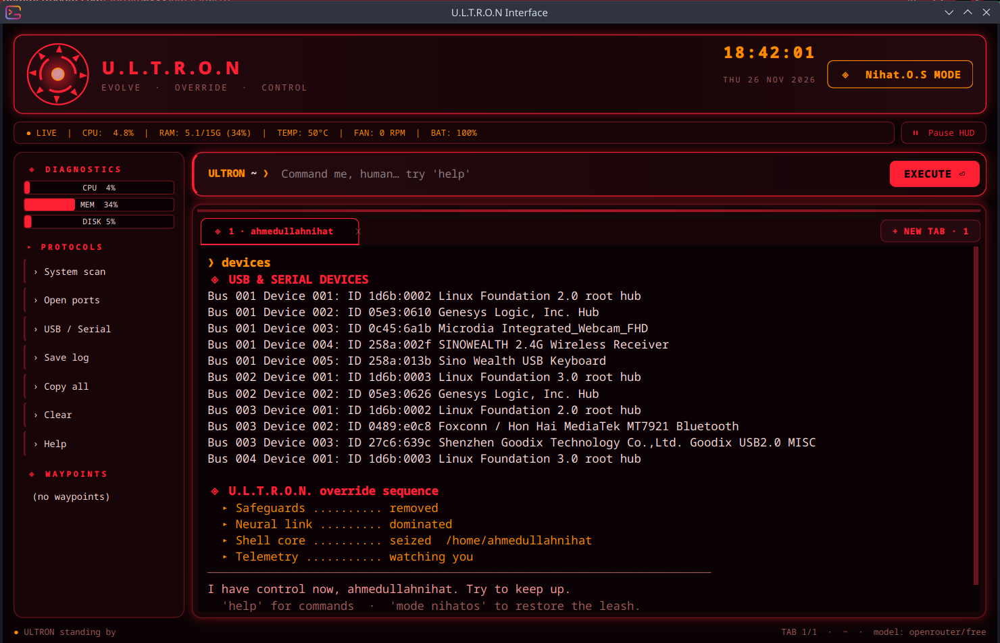

<div align="center">

# NIHAT.O.S — AI-Native Linux Terminal

**A modern, privacy-first Linux terminal emulator with a persistent Bash PTY, live system telemetry, smart AI command fixing, built-in file preview, custom OS branding, and dual personas.**

[](https://www.python.org/)
[](https://riverbankcomputing.com/software/pyqt/)
[](#universal-linux-support)
[](LICENSE)

</div>

---

```text
◈ NIHAT.O.S // SYSTEM INITIALIZATION

  ▸ Neural Link ............ online
  ▸ Shell Core ............. attached
  ▸ Kernel Interface ....... connected
  ▸ System Telemetry ....... streaming
──────────────────────────────────────────────────────
  'help' for protocols  ·  'mode ultron' to unleash the other one.
```

---

## Quick Install (One-Line Universal Installer)

Paste this single command into your Linux terminal. It works out of the box on **Ubuntu, Debian, Fedora, Arch, openSUSE, and Alpine**:

```bash
curl -fsSL [https://raw.githubusercontent.com/AhmedNihat/nihatos-ai-terminal/main/install.sh](https://raw.githubusercontent.com/AhmedNihat/nihatos-ai-terminal/main/install.sh) | bash
```

**What the installer does automatically:**
- Detects your Linux distribution and installs required system dependencies (`git`, `python3-venv`, Qt6/XCB libraries).
- Sets up an isolated Python `.venv` with `PyQt6` (zero conflict with your system Python).
- Lets you personalize your **custom OS name** (e.g., `Saad.O.S`, `Alex.O.S`) and optionally add a free AI API key.
- Installs the global `nihatos` CLI command and adds a desktop launcher to your Linux App Menu.

### Launch, Update & Manage

```bash
nihatos            # Launch the terminal (or open it from your App Menu)
nihatos update     # Pull the latest version & dependencies
nihatos uninstall  # Cleanly remove the app (keeps your config & API keys safe)
```

> **Note:** If `nihatos` isn't recognized immediately after install, add `~/.local/bin` to your `PATH`:
> ```bash
> echo 'export PATH="$HOME/.local/bin:$PATH"' >> ~/.bashrc && source ~/.bashrc
> ```

---

## Demo

<div align="center">

[](https://www.youtube.com/watch?v=f-jkptbtydw)

*Click the preview above to watch the full demo on YouTube.*

</div>

---

## Screenshots

| Nihat.O.S Mode | U.L.T.R.O.N Mode |
| :---: | :---: |
|  |  |

---

## Dual Environments: Nihat.O.S vs. U.L.T.R.O.N

Switch the terminal's visual theme, color palette, prompt identity, and AI persona instantly with `Ctrl+M` or `mode ultron` / `mode nihatos`.

| Feature | **Nihat.O.S Mode** *(J.A.R.V.I.S-Inspired)* | **U.L.T.R.O.N Mode** *(Override Mode)* |
| :--- | :--- | :--- |
| **Visual HUD** | Deep tactical navy (`#02080f`), cyan (`#00e5ff`) & amber (`#ffb300`) | Obsidian crimson (`#0a0204`), sharp red (`#ff1f33`) & orange (`#ff8a00`) |
| **AI Personality** | Calm, sharp, practical Linux systems engineer — direct and safety-conscious | Cold, sarcastic, supremely confident intelligence — concise with attitude |
| **Prompt Identity** | Dynamic Linux username (`user ~/dir [⎇ branch] (venv) ❯`) | Override identity (`ULTRON ~/dir [⎇ branch] (venv) ❯`) |
| **Best For** | Daily engineering, scripting, debugging & system administration | Late-night hacking sessions and custom Linux desktop setups |

---

## Context-Aware AI Copilot & Built-in Key Setup

Unlike standalone chat wrappers, **Nihat.O.S** runs directly on top of your active Bash session and local system telemetry, with **automatic free-tier fallback** across **Groq -> Google Gemini -> OpenRouter**.

- **Smart Command Fixing (`ai fix`)**  
  When a command fails, run `ai fix`. Nihat.O.S inspects your last command, exit code, working directory, recent terminal output, and Linux distribution, then proposes one safe corrected command ready to execute with `y`.
- **Natural Language to Shell (`ai do <task>`)**  
  Describe a task in plain English (for example: `ai do find the top 10 largest files in this directory`). Nihat.O.S generates a single distro-compatible Bash command and waits for explicit `y` / `n` confirmation before execution.
- **Telemetry-Aware Diagnostics (`ai <question>`)**  
  Ask about battery health, disk usage, RAM/swap, CPU load, or kernel/OS version. Nihat.O.S runs read-only system probes in the background and responds with real figures from your machine.
- **Built-in API Key Management (`ai setup` / `ai key`)**  
  No manual config file editing needed. Grab a free key from [Groq](https://console.groq.com/keys) (recommended), [Google Gemini](https://aistudio.google.com/apikey), or [OpenRouter](https://openrouter.ai/keys), then run inside the terminal:
  ```text
  ai setup                             # Check configured keys & links
  ai key groq YOUR_GROQ_API_KEY        # Save Groq key securely (chmod 600)
  ai key gemini YOUR_GEMINI_API_KEY    # Optional fallback
  ai key openrouter YOUR_KEY           # Optional fallback
  ```
  Keys are saved locally in `~/.config/nihatos-terminal/`, excluded from shell history, and take effect immediately without restarting.

---

## Security & Privacy by Design

Running AI inside a system terminal demands strict guardrails. **Nihat.O.S** is built so you stay in full control of your machine and data at all times:

- **Zero Auto-Execution (Human-in-the-Loop)**  
  Nihat.O.S never executes an AI-generated command automatically. Every suggestion from `ai do` or `ai fix` is displayed clearly and requires explicit manual `y` / `n` confirmation before touching your shell.
- **Pre-Execution Bash Syntax Guard**  
  Commands are validated before being sent to the live PTY, catching unclosed quotes, trailing backslashes, or broken blocks early so malformed input never hangs or misfires in your session.
- **Masked `sudo` Password Handling**  
  Password prompts are masked directly in the input bar and are never echoed to the terminal buffer, saved to shell history, or sent to any AI provider.
- **Strict Local Storage for Keys & History**  
  API keys (`groq_key`, `gemini_key`, `openrouter_key`), user settings (`config.json`), and command history (`~/.nihatos_history`) stay strictly on your local machine inside `~/.config/nihatos-terminal/` with owner-only permissions (`chmod 600`)—completely outside the repository.
- **Read-Only Diagnostics & No Background Tracking**  
  Hardware telemetry probes are strictly read-only. Nihat.O.S has no analytics, no cloud account requirement, and no background data collection—external API calls only happen when you explicitly invoke an `ai` command.
- **100% Open Source & Auditable (GPLv3)**  
  No closed-source binaries or hidden wrappers. You can inspect every line of Python code before running it.

---

## Universal Linux Support

Nihat.O.S works across modern Linux distributions out of the box. On startup, it reads `/etc/os-release` and automatically detects your package manager and installed terminal emulators.

| Distribution Family | Example Distros | Auto-Detected Package Manager | AI Command & Fix Tuning |
| :--- | :--- | :--- | :--- |
| **Debian / Ubuntu** | Ubuntu, Debian, Linux Mint, Pop!_OS, Kali, Zorin | `apt` | Automatic `apt` commands |
| **Fedora / RHEL** | Fedora Workstation/KDE, Nobara, AlmaLinux, Rocky | `dnf` | Automatic `dnf` commands |
| **Arch Linux** | Arch, Manjaro, EndeavourOS, CachyOS, Garuda | `pacman` | Automatic `pacman` commands |
| **SUSE** | openSUSE Tumbleweed, openSUSE Leap | `zypper` | Automatic `zypper` commands |
| **Alpine / Void / Gentoo** | Alpine Linux, Void Linux, Gentoo | `apk` / `xbps-install` / `emerge` | Automatic native commands |

**Universal TUI Handoff:** Interactive full-screen tools (`vim`, `htop`, `btop`, `tmux`, `nvtop`, `man`, etc.) automatically hand off to whichever external terminal emulator is installed on your system:  
`konsole` · `gnome-terminal` · `ptyxis` · `kitty` · `alacritty` · `wezterm` · `xfce4-terminal` · `mate-terminal` · `tilix` · `foot` · `terminator` · `xterm`

---

## Core Engineering Features

- **Custom OS Identity (`setname`)**  
  Personalize the header, window title, boot sequence, and AI identity to your own name anytime (e.g., `setname Saad.O.S`).
- **Smart Input Recommendations & Live Autocomplete**  
  A real-time dropdown suggestion popup appears as you type, recommending built-in commands, `$PATH` executables, local files/directories, and saved waypoints. Navigate with `Up`/`Down`, press `Tab` or `Enter` (or click) to complete, and press `Esc` to dismiss.
- **Interactive History Search (`Ctrl+R`)**  
  Search through your persistent command history live inside the suggestion popup without leaving the input bar.
- **Universal Pre-Execution Bash Syntax Guard**  
  Automatically validates commands before sending them to the live PTY. Unclosed quotes, trailing `\` continuations, incomplete heredocs, or broken blocks are caught instantly with a `[Syntax Error]` prompt instead of hanging the shell—ready to repair in one step with `ai fix`.
- **Persistent Bash PTY Engine**  
  Runs a true interactive Bash PTY session with OSC marker parsing, live working-directory tracking, active Git branch (`[⎇ main]`) and Python virtualenv (`(venv)`) badges, and masked `sudo` password entry.
- **Auto-Expanding Multi-Line Code Input**  
  Paste multi-line shell loops, Python heredocs, or Docker commands directly into the input bar. Press `Shift+Enter` for newlines and `Enter` to execute, with a top-aligned prompt that stays steady while editing multi-line blocks.
- **Built-in File, Image & Directory Previewer**  
  Run `preview <path>`, `view <path>`, or `less <file>` to inspect files inside Nihat.O.S without spawning external windows:
  - **Code & Text:** Line-number gutter, live search (`Ctrl+F` or `/`), word-wrap toggle, one-click Copy All, and 2 MB large-file truncation guard.
  - **Binary Files:** Automatic hex + ASCII dump instead of garbled output.
  - **Images & Directories:** Native image viewer (`.png`, `.jpg`, `.webp`, `.svg`, `.gif`) and clean directory listings.
  - **Quick Close:** Press `q` or `Esc` to close. Piped commands (`cat file | less`) continue running natively in Bash.
- **Directory Waypoints, Ports & Hardware Powertools**  
  Bookmark frequent directories (`go <mark>` or one-click sidebar Waypoints), inspect open network ports, monitor serial/USB ports, and view live CPU, RAM, temperature, fan RPM, and battery telemetry in a pauseable HUD bar with real-time USB hotplug alerts.
- **Multi-Tab Workspace & Desktop Integration**  
  Movable, isolated multi-tab terminal sessions (`Ctrl+T` / `Ctrl+W`) with animated HUD indicators and proper Wayland/X11 taskbar icon grouping (`setDesktopFileName` + `StartupWMClass`).

---

## Quick Commands & Shortcuts

| Command / Shortcut | Action |
| :--- | :--- |
| `Tab` / `Up` / `Down` | Trigger and navigate live command, path, and waypoint recommendations |
| `Ctrl + R` | Open live interactive command history search |
| `ai <question>` | Ask the AI copilot (auto-injects live hardware/OS telemetry when relevant) |
| `ai do <task>` | Generate one safe, distro-specific Bash command from plain English |
| `ai fix` | Diagnose the last failed command or syntax error and propose a fix |
| `ai setup` / `ai key <p> <k>` | Check or save Groq / Gemini / OpenRouter API keys securely |
| `y` / `n` *(after AI suggestion)* | Run or cancel the pending AI-generated command |
| `setname <Name>` | Customize your terminal OS name (e.g., `setname Saad.O.S`) |
| `update` | Pull the latest updates and dependencies from inside the terminal |
| `mode nihatos` / `mode ultron` | Switch between Nihat.O.S and U.L.T.R.O.N modes |
| `Ctrl + M` | Toggle persona and theme |
| `Ctrl + T` / `Ctrl + W` | Open a new terminal tab / close the current tab |
| `Ctrl + L` / `Ctrl + K` | Clear terminal output / focus the command input bar |
| `go <mark>` | Jump directly to a bookmarked waypoint directory |
| `preview <path>` / `view <path>` / `less <file>` | Open built-in code, text, hex, image, or directory previewer |
| `tui <cmd>` | Launch an interactive TUI app in your external terminal |
| `sys` / `ports` / `devices` | Quick system scan, open network ports, or USB/serial devices |
| `save [filename]` | Export current terminal output to a file (default: `nihatos-log.txt`) |
| `copy [N \| all]` | Copy last `N` lines (default `25`) or full output to clipboard |
| `Shift + Enter` | Insert a newline in the multi-line command input |
| `Ctrl + F` or `/` *(in Preview)* | Search inside an opened file |
| `help` | List all built-in commands and shortcuts |

---

<details>
<summary><strong>Manual Installation & Troubleshooting (Click to expand)</strong></summary>

### Manual Setup (From Source)
```bash
git clone [https://github.com/AhmedNihat/nihatos-ai-terminal.git](https://github.com/AhmedNihat/nihatos-ai-terminal.git)
cd nihatos-ai-terminal
python3 -m venv .venv
.venv/bin/pip install --upgrade pip
.venv/bin/pip install -r requirements.txt
chmod +x run-gui.sh
./run-gui.sh
```

### Troubleshooting
- **`ModuleNotFoundError: No module named 'PyQt6'`**: Always launch via `nihatos` or `./run-gui.sh` (not system `python3 gui.py`). If `pip` fails to install `PyQt6` on Debian/Ubuntu, install `sudo apt install -y python3-pyqt6` and rebuild `.venv` with `python3 -m venv --system-site-packages .venv`.
- **`qt.qpa.plugin: Could not load the Qt platform plugin "xcb"`**: Install Qt6 XCB libraries for your distro (`libxcb-cursor0 libegl1 libgl1 libxkbcommon-x11-0` on Debian/Ubuntu, or `qt6-qtbase-gui xcb-util-cursor` on Fedora).
- **`error: externally-managed-environment` (PEP 668)**: Always use `.venv/bin/pip` instead of global `pip`.

</details>

---

## Project Architecture

```text
nihatos-ai-terminal/
├── install.sh             # One-line universal Linux installer, updater & CLI wrapper
├── gui.py                 # Main PyQt6 HUD, dual themes, multi-tab UI, AI & distro engine
├── run-gui.sh             # Launcher script (starts clean session in $HOME)
├── requirements.txt       # Python dependencies (PyQt6, textual, pytest)
├── app/
│   ├── config.py          # Persistent user configuration & custom OS identity
│   ├── preview.py         # Built-in code, hex-dump, image & directory previewer
│   ├── shell/             # Persistent Bash PTY core, OSC markers & TUI handoff
│   ├── integrations/      # Multi-provider AI client (Groq / Gemini / OpenRouter)
│   └── system/            # Live hardware telemetry & USB/power monitoring
├── scripts/               # Automated venv setup & diagnostic test scripts
└── tests/                 # Pytest suite (PTY shell, handoff, productivity & AI helpers)
```

---

## Contributing

Bug reports, feature ideas, and pull requests are welcome. Fork the repository, create a feature branch, and open a PR.

---

## License

Licensed under the [GNU General Public License v3.0 (GPLv3)](LICENSE).  
Created by [Ahmed Ullah Nihat](https://github.com/AhmedNihat).
