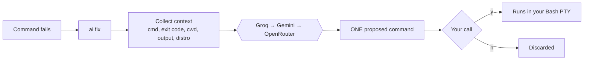

<div align="center">


<a href="https://github.com/AhmedNihat/nihatos-ai-terminal">
  <picture>
    <source media="(prefers-color-scheme: dark)" srcset="https://readme-typing-svg.demolab.com?font=JetBrains+Mono&weight=600&size=20&duration=3200&pause=900&color=00E5FF&center=true&vCenter=true&width=760&height=44&lines=Your+Bash.+Your+machine.+Your+AI.;ai+fix%3A+one+safe+command%2C+you+press+y+or+n;Groq+to+Gemini+to+OpenRouter%2C+auto+fallback;Zero+tracking.+100%25+open+source.">
    
  </picture>
</a>

<br>

**A privacy-first Linux terminal emulator (`Nihat.O.S`) with a persistent Bash PTY, live system telemetry, AI command fixing, a built-in file previewer, custom OS branding, and two switchable personas.**

<br>

<a href="https://www.python.org/"></a>
<a href="https://riverbankcomputing.com/software/pyqt/"></a>
<a href="#universal-linux-support"></a>
<a href="LICENSE"></a>

<a href="https://github.com/AhmedNihat/nihatos-ai-terminal/stargazers"></a>
<a href="https://github.com/AhmedNihat/nihatos-ai-terminal/network/members"></a>
<a href="https://github.com/AhmedNihat/nihatos-ai-terminal/issues"></a>
<a href="https://github.com/AhmedNihat/nihatos-ai-terminal/commits/main"></a>
<a href="https://ahmedullahnihat.gumroad.com/l/hqsqry"></a>

<br><br>

<a href="#demo"><b>Demo</b></a> &nbsp;·&nbsp;
<a href="#quick-install"><b>Install</b></a> &nbsp;·&nbsp;
<a href="#ai-copilot"><b>AI Copilot</b></a> &nbsp;·&nbsp;
<a href="#dual-personas"><b>Personas</b></a> &nbsp;·&nbsp;
<a href="#security-and-privacy"><b>Security</b></a> &nbsp;·&nbsp;
<a href="#universal-linux-support"><b>Distros</b></a> &nbsp;·&nbsp;
<a href="#commands-and-shortcuts"><b>Commands</b></a>

</div>

---

## Demo

<div align="center">

<a href="https://www.youtube.com/watch?v=f-jkptbtydw">
  
</a>

<br><br>

<a href="https://www.youtube.com/watch?v=f-jkptbtydw"></a>

</div>

### Screenshots

<div align="center">

<table>
  <tr>
    <td align="center" width="50%">
      <br>
      <b>Nihat.O.S</b><br>
      <sub>Tactical navy · calm, practical AI</sub>
    </td>
    <td align="center" width="50%">
      <br>
      <b>U.L.T.R.O.N</b><br>
      <sub>Obsidian crimson · cold, sarcastic AI</sub>
    </td>
  </tr>
</table>

</div>

---

## See It In Action

```text
nihat ~/projects/api [⎇ main] (venv) ❯ sudo apt instal htop
E: Invalid operation instal

nihat ~/projects/api [⎇ main] (venv) ❯ ai fix
  ◈ context   exit=100 · cwd=~/projects/api · distro=Ubuntu 24.04 · pm=apt
  ◈ proposal  sudo apt install htop
  Run it? [y/n] ❯ y

nihat ~/projects/api [⎇ main] (venv) ❯ ai do find the 10 largest files in this directory
  ◈ proposal  du -ah . 2>/dev/null | sort -rh | head -n 10
  Run it? [y/n] ❯ _
```

<sub><i>Illustrative session.</i></sub>

<table>
  <tr>
    <td valign="top" width="33%">
      <b>🧠 Context-Aware AI</b><br><br>
      Sees your last command, exit code, cwd, recent output and distro. Not just a blank chat box.
    </td>
    <td valign="top" width="33%">
      <b>🛡️ Human-in-the-Loop</b><br><br>
      Nothing AI-generated ever runs without your explicit <code>y</code>.
    </td>
    <td valign="top" width="33%">
      <b>🖥️ Persistent Bash PTY</b><br><br>
      A real interactive shell with live cwd, Git branch and venv badges.
    </td>
  </tr>
  <tr>
    <td valign="top">
      <b>📊 Live Telemetry</b><br><br>
      CPU, RAM, temperature, battery, open ports and USB/serial hotplug alerts.
    </td>
    <td valign="top">
      <b>🔍 Built-in Previewer</b><br><br>
      Code with line numbers, hex dumps, images and directories, all inside the terminal.
    </td>
    <td valign="top">
      <b>🎭 Dual Personas</b><br><br>
      Switch between calm <b>Nihat.O.S</b> and sarcastic <b>U.L.T.R.O.N</b> with <code>Ctrl+M</code>.
    </td>
  </tr>
</table>

---

## Quick Install

One line. Works on **Ubuntu, Debian, Fedora, Arch, openSUSE and Alpine**, with no `sudo` required:

```bash
curl -fsSL https://raw.githubusercontent.com/AhmedNihat/nihatos-ai-terminal/main/install.sh | bash
```

<details>
<summary><b>Prefer to read the script before running it?</b></summary>

<br>

```bash
curl -fsSLO https://raw.githubusercontent.com/AhmedNihat/nihatos-ai-terminal/main/install.sh
less install.sh
bash install.sh
```

</details>

**What the installer does:**

* Detects your distro, architecture and desktop environment.
* Creates an isolated Python `.venv` with `PyQt6`, so there is zero conflict with your system Python.
* Installs the `nihatos` CLI and adds a launcher to your App Menu and Desktop.
* Ships with built-in update, API-key reset and safe-uninstall commands.

### Launch, Update & Manage

```bash
nihatos            # Launch the terminal (or open it from your App Menu / Desktop)
nihatos update     # Pull the latest version and dependencies
nihatos key-clear  # Delete all saved AI API keys for a fresh setup
nihatos uninstall  # Cleanly remove the app (asks whether to keep or delete API keys)
```

> [!TIP]
> If `nihatos` is not recognized right after install, add `~/.local/bin` to your `PATH`:
> ```bash
> echo 'export PATH="$HOME/.local/bin:$PATH"' >> ~/.bashrc && source ~/.bashrc
> ```

---

## Why Linux AI Terminal

| | Typical AI chat wrapper | **Linux AI Terminal** |
| --- | --- | --- |
| **Shell** | Stateless, or a fresh process per command | Persistent Bash PTY |
| **Context** | Whatever you paste in | Last command, exit code, cwd, output, distro, live telemetry |
| **Execution** | Copy-paste, or blind auto-run | Explicit `y` / `n` confirmation every time |
| **Providers** | One vendor | Automatic fallback: Groq → Gemini → OpenRouter |
| **Privacy** | Accounts and analytics | Local keys, no analytics, no cloud account |
| **Auditability** | Closed or opaque | 100% open source (GPLv3) |

---

## Dual Personas

Switch theme, palette, prompt identity and AI personality instantly with `Ctrl+M`, or `mode ultron` / `mode nihatos`.

| | **Nihat.O.S** *(J.A.R.V.I.S-inspired)* | **U.L.T.R.O.N** *(override mode)* |
| --- | --- | --- |
| **Visual HUD** | Tactical navy `#02080f`, cyan `#00e5ff`, amber `#ffb300` | Obsidian crimson `#0a0204`, red `#ff1f33`, orange `#ff8a00` |
| **AI personality** | Calm, sharp, practical systems engineer. Direct and safety-conscious. | Cold, sarcastic, supremely confident. Concise, with attitude. |
| **Prompt** | `user ~/dir [⎇ branch] (venv) ❯` | `ULTRON ~/dir [⎇ branch] (venv) ❯` |
| **Best for** | Daily engineering, scripting, debugging, sysadmin | Late-night hacking and custom Linux desktop setups |

---

## AI Copilot

Runs directly on top of your live Bash session and local telemetry, with **automatic free-tier fallback** across **Groq → Google Gemini → OpenRouter**.



| Command | What it does |
| --- | --- |
| `ai fix` | Inspects your last command, exit code, cwd, recent output and distro, then proposes **one** safe corrected command, ready to run with `y`. |
| `ai do <task>` | Plain English to a single distro-compatible Bash command. Waits for explicit `y` / `n`. Example: `ai do find the top 10 largest files here` |
| `ai <question>` | Runs read-only probes (battery, disk, RAM/swap, CPU load, kernel/OS) and answers with **real figures from your machine**. |
| `ai setup` | Shows which API keys are configured, with links to get free ones. |

### Built-in API Key Setup

No config-file editing. Grab a free key from [Groq](https://console.groq.com/keys) (recommended), [Google Gemini](https://aistudio.google.com/apikey) or [OpenRouter](https://openrouter.ai/keys), then run inside the terminal:

```text
ai setup                             # Check configured keys and links
ai key groq YOUR_GROQ_API_KEY        # Save Groq key securely (chmod 600)
ai key gemini YOUR_GEMINI_API_KEY    # Optional fallback
ai key openrouter YOUR_KEY           # Optional fallback
ai key delete <provider>             # Delete one key (or: ai key delete all)
ai key clear                         # Clear all saved API keys
```

> [!NOTE]
> Keys live in `~/.config/nihatos-terminal/`, stay out of shell history, and take effect immediately with no restart.

---

## Security and Privacy

Running AI inside a system terminal demands strict guardrails. You stay in control of your machine and your data at all times.

| Guardrail | What it means |
| --- | --- |
| **Zero auto-execution** | Every suggestion from `ai do` or `ai fix` needs a manual `y` / `n`. Nothing runs on its own. |
| **Pre-execution syntax guard** | Catches unclosed quotes, trailing backslashes and broken blocks *before* they reach the PTY, so malformed input never hangs your shell. |
| **Masked `sudo` prompts** | Password input is masked and never echoed to the buffer, saved to history, or sent to any AI provider. |
| **Strict local storage** | API keys, `config.json` and history (`~/.nihatos_history`) stay inside `~/.config/nihatos-terminal/` with owner-only permissions (`chmod 600`). |
| **Read-only diagnostics** | System probes only read. No writes, no side effects. |
| **Zero tracking** | No analytics, no cloud accounts. External API calls happen only when you explicitly run an `ai` command. |
| **Open and auditable** | GPLv3. Read every line before you run it. |

> [!IMPORTANT]
> AI can be wrong. Always read the proposed command before pressing `y`, especially with `sudo`, `rm`, `dd` or anything that touches disks.

---

## Universal Linux Support

On startup it reads `/etc/os-release` and auto-detects your package manager and installed terminal emulators.

| Family | Example distros | Package manager | AI tuning |
| --- | --- | --- | --- |
| **Debian / Ubuntu** | Ubuntu, Debian, Linux Mint, Pop OS, Kali, Zorin | `apt` | Native `apt` commands |
| **Fedora / RHEL** | Fedora, Nobara, AlmaLinux, Rocky | `dnf` | Native `dnf` commands |
| **Arch** | Arch, Manjaro, EndeavourOS, CachyOS, Garuda | `pacman` | Native `pacman` commands |
| **SUSE** | openSUSE Tumbleweed, openSUSE Leap | `zypper` | Native `zypper` commands |
| **Alpine / Void / Gentoo** | Alpine, Void, Gentoo | `apk` / `xbps-install` / `emerge` | Native commands |

**Universal TUI handoff.** Full-screen tools (`vim`, `htop`, `btop`, `tmux`, `nvtop`, `man`, ...) automatically open in whichever terminal emulator you have installed:

`konsole` · `gnome-terminal` · `ptyxis` · `kitty` · `alacritty` · `wezterm` · `xfce4-terminal` · `mate-terminal` · `tilix` · `foot` · `terminator` · `xterm`

---

## Core Features

* **Persistent Bash PTY engine.** A true interactive Bash session with live cwd tracking, Git branch (`[⎇ main]`), Python venv (`(venv)`) badges and masked `sudo` entry.
* **Custom OS identity (`setname`).** Rename the header, window title, boot sequence and AI identity anytime, e.g. `setname Saad.O.S`.
* **Smart autocomplete.** Live suggestions for built-ins, `$PATH` executables, files, directories and saved waypoints.
* **Interactive history search (`Ctrl+R`).** Search persistent history right inside the suggestion popup.
* **Pre-execution Bash syntax guard.** Instant `[Syntax Error]` prompt, ready for `ai fix`.
* **Multi-line input.** Paste loops or heredocs directly. `Shift+Enter` for a newline, `Enter` to run.
* **Built-in previewer.** `preview <path>`, `view <path>` or `less <file>`:
  * **Code and text:** line-number gutter, live search (`Ctrl+F` or `/`), word-wrap toggle, one-click Copy All, 2 MB large-file guard.
  * **Binary files:** automatic hex + ASCII dump instead of garbled output.
  * **Images and directories:** native viewer for `.png`, `.jpg`, `.webp`, `.svg`, `.gif`, plus clean directory listings.
  * **Quick close:** `q` or `Esc`. Piped commands (`cat file | less`) keep running natively in Bash.
* **Waypoints, ports and hardware tools.** Bookmark directories (`go <mark>`), inspect open ports, watch USB/serial devices with hotplug alerts, track CPU, RAM, temperature and battery.
* **Multi-tab workspace.** Isolated, movable tabs (`Ctrl+T` / `Ctrl+W`) with proper Wayland/X11 taskbar icon grouping.

---

## Commands and Shortcuts

### AI

| Command | Action |
| --- | --- |
| `ai <question>` | Ask the copilot (live hardware/OS telemetry is injected when relevant) |
| `ai do <task>` | Generate one safe, distro-specific Bash command from plain English |
| `ai fix` | Diagnose the last failed command or syntax error and propose a fix |
| `ai setup` | Check configured API keys |
| `ai key <provider> <key>` | Save a Groq / Gemini / OpenRouter key securely |
| `ai key delete <provider>` | Delete one saved key (use `all` for every key) |
| `ai key clear` | Clear all saved API keys |
| `y` / `n` | Run or cancel the pending AI-generated command |

### Terminal and Workspace

| Shortcut / Command | Action |
| --- | --- |
| `Tab` / `Up` / `Down` | Trigger and navigate command, path and waypoint suggestions |
| `Ctrl + R` | Live history search |
| `Shift + Enter` | Newline in multi-line input |
| `Ctrl + T` / `Ctrl + W` | New tab / close tab |
| `Ctrl + L` / `Ctrl + K` | Clear output / focus the input bar |
| `Ctrl + M` | Toggle persona and theme |
| `go <mark>` | Jump to a bookmarked waypoint |
| `tui <cmd>` | Launch an interactive TUI app in your external terminal |

### Tools and Customization

| Command | Action |
| --- | --- |
| `preview <path>` / `view <path>` / `less <file>` | Built-in code, text, hex, image or directory previewer |
| `sys` / `ports` / `devices` | System scan, open network ports, USB/serial devices |
| `save [filename]` | Export terminal output to a file (default: `nihatos-log.txt`) |
| `copy [N]` / `copy all` | Copy last `N` lines (default `25`) or the full output to the clipboard |
| `setname <Name>` | Rename your terminal OS, e.g. `setname Saad.O.S` |
| `mode nihatos` / `mode ultron` | Switch persona |
| `update` | Pull the latest updates from inside the terminal |
| `help` | List all built-in commands and shortcuts |

---

<details>
<summary><b>Manual setup (from source)</b></summary>

<br>

```bash
git clone https://github.com/AhmedNihat/nihatos-ai-terminal.git
cd nihatos-ai-terminal
python3 -m venv .venv
.venv/bin/pip install --upgrade pip
.venv/bin/pip install -r requirements.txt
chmod +x run-gui.sh
./run-gui.sh
```

</details>

<details>
<summary><b>Troubleshooting</b></summary>

<br>

* **`ModuleNotFoundError: No module named 'PyQt6'`**
  Always launch via `nihatos` or `./run-gui.sh`, not `python3 gui.py`. If `pip` fails to install `PyQt6` on Debian/Ubuntu, run `sudo apt install -y python3-pyqt6` and rebuild the venv with `python3 -m venv --system-site-packages .venv`.
* **`qt.qpa.plugin: Could not load the Qt platform plugin "xcb"`**
  Install the Qt6 XCB libraries: `libxcb-cursor0 libegl1 libgl1 libxkbcommon-x11-0` on Debian/Ubuntu, or `qt6-qtbase-gui xcb-util-cursor` on Fedora.
* **`error: externally-managed-environment` (PEP 668)**
  Always use `.venv/bin/pip` instead of the global `pip`.

</details>

<details>
<summary><b>Project architecture</b></summary>

<br>

```text
nihatos-ai-terminal/
├── install.sh             # One-line universal installer, updater and CLI wrapper
├── gui.py                 # PyQt6 HUD, dual themes, multi-tab UI, AI and distro engine
├── run-gui.sh             # Launcher script (starts a clean session in $HOME)
├── requirements.txt       # Python dependencies (PyQt6, textual, pytest)
├── assets/                # README screenshots
├── app/
│   ├── config.py          # Persistent user configuration and custom OS identity
│   ├── preview.py         # Built-in code, hex-dump, image and directory previewer
│   ├── shell/             # Persistent Bash PTY core, OSC markers and TUI handoff
│   ├── integrations/      # Multi-provider AI client (Groq / Gemini / OpenRouter)
│   └── system/            # Live hardware telemetry and USB/power monitoring
├── scripts/               # Automated venv setup and diagnostic scripts
└── tests/                 # Pytest suite (PTY shell, handoff, productivity, AI helpers)
```

</details>

---

## Contributing

Bug reports, feature ideas and pull requests are welcome.

1. Fork the repository
2. Create a feature branch: `git checkout -b feat/my-idea`
3. Commit and push your changes
4. Open a Pull Request

---

## Support the Project

This project is 100% free and open source. If it saves you time or improves your Linux workflow, a ⭐ on GitHub or a coffee helps keep development going.

<div align="center">

<a href="https://ahmedullahnihat.gumroad.com/l/hqsqry"></a>

<br><br>

<a href="https://star-history.com/#AhmedNihat/nihatos-ai-terminal&Date">
  <picture>
    <source media="(prefers-color-scheme: dark)" srcset="https://api.star-history.com/svg?repos=AhmedNihat/nihatos-ai-terminal&type=Date&theme=dark" />
    <source media="(prefers-color-scheme: light)" srcset="https://api.star-history.com/svg?repos=AhmedNihat/nihatos-ai-terminal&type=Date" />
    
  </picture>
</a>

</div>

---

## License

Licensed under the [GNU General Public License v3.0 (GPLv3)](LICENSE).

<div align="center">

Created by [Ahmed Ullah Nihat](https://github.com/AhmedNihat)

<a href="#top"><sub>↑ Back to top</sub></a>

</div>
